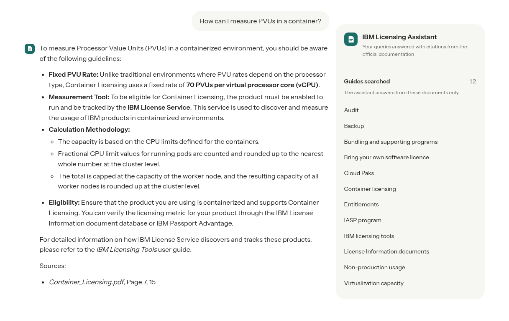
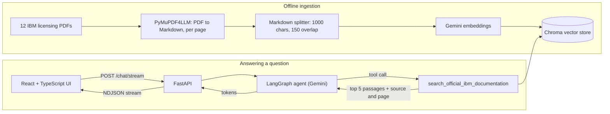

# IBM Licensing Helper

**An AI assistant that answers IBM software licensing questions using only IBM's official licensing guides, and cites the document and page behind every answer.**

**Live demo:** https://ibm-licensing-helper.onrender.com/ 
*(Hosted on a free tier: if the app has been idle, the first answer can take up to a minute while the server wakes up.)*



---

## The problem

IBM software licensing is notoriously complex. Whether a deployment is compliant depends on rules like Processor Value Units (PVUs), sub-capacity licensing, virtualization capacity, container licensing and Cloud Pak entitlements. Those rules are spread across dozens of pages of separate PDF guides.

Getting it wrong is expensive: licensing gaps usually surface during an audit, as unplanned costs.

A general-purpose chatbot is not a safe tool here. It answers confidently from its training data, may be out of date, can invent rules, and can't tell you where an answer came from.

## What this project does

IBM Licensing Helper is a retrieval-augmented generation (RAG) assistant designed to be trusted:

- **Grounded:** it answers only from 12 official IBM licensing guides, never from the model's general knowledge.
- **Cited:** every answer names the guide and page it used, so the reader can verify it.
- **Honest:** if the guides don't cover a question, it says "Answer not available" instead of guessing.
- **Focused:** it declines questions unrelated to IBM licensing.
- **Conversational:** follow-up questions ("what about containers?") keep the context of the conversation.
- **Responsive:** answers stream in as they're generated.

## How it works



### 1. Ingestion: turning PDFs into searchable knowledge
`data/ingest.py`:
- converts each guide to Markdown page by page with **PyMuPDF4LLM**, so headings, lists and tables keep their structure and every chunk remembers its page number;
- splits the text into overlapping 1,000-character chunks;
- embeds them with Google's **`gemini-embedding-001`**;
- stores them in a persistent **Chroma** vector database.

Embedding requests are batched and throttled to stay within the API's rate limits.

### 2. The agent: deciding when and what to search
The core is a **LangGraph** state graph with two nodes in a loop:

- **`chat`:** a Gemini model with one tool bound to it. A system prompt sets the rules:
  - answer only from retrieved documentation;
  - cite the document name and page;
  - refuse off-topic questions;
  - never expose internal file paths.
- **`tools`:** runs `search_official_ibm_documentation`, a semantic search over Chroma. It returns the top 5 passages, each labelled with its source document and page.

The model decides whether a question needs a search. When it searches, it writes the search query itself: the tool's description tells it to turn follow-ups into self-contained queries, so "is that true for containers too?" becomes a full question before retrieval.

Conversation history is managed by a LangGraph **checkpointer** keyed by a per-chat session id.

### 3. The API: streaming answers token by token
**FastAPI** exposes `POST /chat/stream`:
- **Validation:** requests are checked with Pydantic; questions must be 1–1,500 characters.
- **Streaming:** the endpoint runs the graph in LangGraph's `messages` streaming mode and filters the stream so only the model's answer text reaches the user, never the raw retrieved passages.
- **Format:** it sends newline-delimited JSON events (`session`, `token`, `error`, `done`), so the client can show text as it arrives and handle failures cleanly.
- **Configuration:** CORS origins are configurable through environment variables, and `/health` serves the hosting platform's health checks.

### 4. The frontend: a focused chat interface
- **Stack:** **React 19 + TypeScript**, built with **Vite**.
- **Stream reading:** an async generator reads the response stream with the Fetch API's `ReadableStream`. It buffers partial lines and parses each event as it arrives.
- **Rendering:** answers render as Markdown (lists, emphasis, tables) while they stream in.
- **Interface:** a responsive layout, an auto-growing message box, example questions, and a panel listing the guides the assistant draws on.

### 5. Deployment
Both halves deploy from GitHub to **Render**: the frontend as a static site, and the API as a Python web service. Configuration (API keys, model names, allowed origins, API URL) lives in environment variables, not in code.

## Design evolution
The first version used a fixed pipeline with three separate model calls per question:
1. a classifier that judged whether the question was about licensing;
2. a rewriter that made follow-up questions self-contained;
3. a generator that answered from the retrieved passages.

It ran on a Streamlit UI.

The current version replaces that pipeline with **tool calling**: one model decides for itself whether to search and how to phrase the search. This cut the number of model calls per question, handled follow-up questions more naturally, and left a simpler graph. The Streamlit UI was replaced by a separate **FastAPI backend and React frontend**, which allowed streaming and independent deployment.

## Tech stack

| Area | Technologies |
|---|---|
| Language models | Google Gemini (generation), `gemini-embedding-001` (embeddings) |
| Orchestration | LangGraph, LangChain |
| Retrieval | Chroma vector database, PyMuPDF4LLM, LangChain text splitters |
| Backend | Python 3.13, FastAPI, Pydantic, uv |
| Frontend | React 19, TypeScript, Vite, react-markdown |
| Observability | LangSmith tracing (optional) |
| Hosting | Render (static site + web service) |

## Project structure

```
├── data/
│   ├── Licensing_documents/   # the 12 IBM licensing guides (PDF)
│   └── ingest.py              # builds the vector database
├── src/
│   ├── agent.py               # LangGraph agent, retrieval tool, system prompt
│   ├── api.py                 # FastAPI app and streaming endpoint
│   └── ibm_oracle_db/         # persisted Chroma database
├── frontend/                  # React + TypeScript + Vite app
├── langgraph.json             # config for LangGraph Studio
└── pyproject.toml / uv.lock   # Python dependencies
```

## Running it locally

**Prerequisites:** Python 3.13 with [uv](https://docs.astral.sh/uv/), Node.js 22, and a Google Gemini API key.

1. **Configure:** create `.env` in the project root:
   ```
   GEMINI_API_KEY=your-key
   GEMINI_GENERATION_MODEL=your-gemini-model
   GEMINI_EMBEDDING_MODEL=gemini-embedding-001
   ```
2. **Start the API:**
   ```bash
   uv sync
   cd src && uv run fastapi dev api.py     # http://127.0.0.1:8000
   ```
3. **Start the frontend,** in a second terminal:
   ```bash
   cd frontend
   npm install
   npm run dev                             # http://localhost:5173
   ```

The vector database is committed, so ingestion isn't needed to try the app. To rebuild it after changing the documents, run `uv run python data/ingest.py` from the project root and move the generated `ibm_oracle_db/` folder into `src/`.

To inspect the agent step by step in LangGraph Studio, run `uv run langgraph dev`.

## Limitations and next steps
- **Session memory is in-process.** Conversations reset when the server restarts. The next step is a persistent checkpointer, such as Postgres or SQLite.
- **No access control yet.** A shared password or rate limiting would protect the API quota on a public deployment.
- **Containerisation.** Packaging the app with Docker would make deployment reproducible.
- **Answer-quality evaluation.** A test set of licensing questions with expected answers and sources would make retrieval and prompt changes measurable.

## Disclaimer
This is an independent learning project, not affiliated with or endorsed by IBM. Answers are informational: always confirm against the cited page and your IBM agreements before making licensing decisions. The guides in `data/Licensing_documents/` are IBM publications and remain IBM's property.
